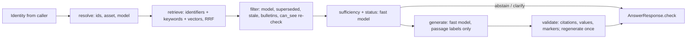

# Implementation Plan: Answer Engine

**Branch**: `002-answer-engine` | **Date**: 2026-10-12 | **Spec**: [spec.md](spec.md)

**Input**: Feature specification from `/specs/002-answer-engine/spec.md`

## Summary

A Python library implementing `copilot_contracts.AnswerEngine`: given an `Identity` (from the
session) and an `AskRequest`, it runs a fixed pipeline (resolve asset, retrieve, filter
applicability, check sufficiency, generate, validate citations) and returns an `AnswerResponse`
that passes `check()`. Retrieval, applicability, restricted detection, precedence and citation
validation are deterministic code; the model is used only to judge sufficiency/choose the status
and to write sentences from supplied passages. Decisions are in [research.md](research.md).

## Technical Context

**Language/Version**: Python 3.12 (uv)

**Primary Dependencies**: pydantic 2, psycopg 3 + pgvector, openai (through
`copilot_ingest.providers.openai_provider.OpenAIProvider`), PyYAML, typer. No new dependencies.

**Storage**: PostgreSQL `copilot`, read only through `serving.*` (published dataset, ds_0027 at
time of writing). Disk cache for model calls and embeddings in `data/answer_cache/`.

**Testing**: pytest. Unit tests offline with an in-memory serving fake and a fake model; one
`@pytest.mark.hosted` golden run; integration tests (local DB, no model calls) marked
`integration`.

**Target Platform**: in-process library inside the answer API (003); a CLI for manual tests.

**Project Type**: library + CLI.

**Performance Goals**: p95 ≤ 15 s to a first useful answer (SC-005); ≤ 3 US cents per question
(SC-006).

**Constraints**: zero restricted disclosures; every sentence validated; offline tests.

**Scale/Scope**: one corpus of ~1,800 passages, 12 test users, 10 golden questions.

## Pipeline



## Constitution Check

| Principle | How the design satisfies it |
|---|---|
| I. Authorization outside the model | Groups come only from `Identity`. Every read is a `serving.*` function with those groups (filtering before ranking). `serving.can_see` is re-checked per passage just before the prompt. The model never sees text the user can't read. Caches are keyed by the exact group set and dataset version. `not_visible` is decided from unrestricted reference data. |
| II. Grounded and verifiable | Every sentence carries citations to supplied passages; the deterministic validator (R7) checks values, part numbers, fault codes, case numbers, asset IDs and serials against cited text; failures are regenerated once, then removed; nothing left → abstain. Restricted responses are also cited. Withheld scan values stay as `unverified` segments. |
| III. Abstain rather than guess | Deterministic and model sufficiency gates before generation (R3); other-model evidence removed before the gate (R4); ambiguous machines → `clarify` (R6). |
| IV. Applicability and authority by code | Asset resolved from `serving.assets`/aliases first; model, superseded, stale and bulletin status decided by code (R4); conflict `preferred` decided by code (R8). |
| V. Restricted procedures | Restricted content never reaches the model (ACL); status `restricted` when visible passages name an unsatisfied procedure the question asks to perform; output guard drops steps and markers for unsatisfied procedures on every response (R5). |
| VI. Drafts, humans commit | The engine only returns a `work_order_suggestion`; it writes to no external system. Audit logging is the API's job (003). |
| VII. Measured | Offline unit tests for each deterministic stage; hosted golden run recorded in `golden-run.md` with outcome, latency and cost per question; failures categorised by stage. |
| VIII. Simplest architecture | One fixed pipeline, two to three fast-model calls, no agents, no tools, no new services. |

No violations; Complexity Tracking is empty.

## Project Structure

### Documentation (this feature)

```text
specs/002-answer-engine/
├── spec.md
├── plan.md          # this file
├── research.md      # decisions R1–R10
├── tasks.md
└── golden-run.md    # hosted run over eval/questions.json
```

### Source Code

```text
src/copilot_answer/
├── __init__.py       # Engine, build_engine
├── __main__.py       # CLI: python -m copilot_answer ask --user u03 "question"
├── config.py         # weights, k, prices, markers, prompt versions
├── identity.py       # Identity from users.json (CLI only; the API builds its own)
├── serving.py        # Serving protocol + Postgres implementation (serving.* only)
├── ids.py            # identifier recognition
├── resolve.py        # asset / model / site resolution, clarify decision
├── retrieve.py       # hybrid retrieval + RRF + parent/child consolidation
├── applicability.py  # model filter, superseded, stale, bulletins, can_see re-check
├── restricted.py     # unsatisfied procedures, candidate detection, marker guard
├── llm.py            # cached model client, cost logging, fake for tests
├── prompts.py        # sufficiency and generation prompts + JSON schemas
├── validate.py       # deterministic citation validator
├── build.py          # citations, segments, notices, conflicts, work-order suggestion
└── engine.py         # the pipeline

tests/answer/         # offline unit tests + hosted golden run
```

**Structure Decision**: one new package next to `copilot_ingest` and `copilot_contracts`, added to
`[tool.hatch.build.targets.wheel] packages`.

## Contract notes and proposed changes

Outcome (orchestrator DECISION 2026-10-12 20:15): 1, 2 (with embedding and distance), 3 and 5
accepted and built into the contract; 4 declined for v1. The engine follows the new contract.

1. **Asset record as grounding** (answer.md guarantee 2): the example `answer.json` states
   "FRS-P-0031 is serial HCP350-241187" citing a bulletin passage that contains neither value. The
   engine accepts asset ID, serial, model, firmware and site of the *resolved asset record* as
   grounded. Proposed wording: "…appears in at least one of that sentence's cited passages, or is a
   field of the resolved `asset`."
2. **`not_visible` detection**: no serving function says "hidden content exists for these
   identifiers". The engine infers it from unrestricted reference data (model/asset exists, user
   sees no passage tagged with it). A `serving.hidden_exists(groups, ids) RETURNS boolean` would be
   more precise.
3. **Restricted without an asset**: `WorkOrderSuggestion.asset_id` is required, so a restricted
   answer for a model-level question cannot carry a suggestion (FR-016). Proposal: make `asset_id`
   optional, or accept that FR-016 applies only when an asset is resolved.
4. **Model-level clarification**: `ClarifyOption.asset_id` is required, so "which model?" (fault
   code shared by several models) cannot be asked; the engine answers with per-model labelling.
5. **timings_ms** has extra keys `sufficiency` and `total` besides the five listed steps.

## Complexity Tracking

None.
