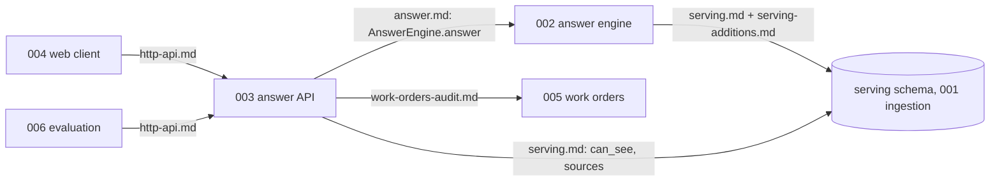

# Shared contracts

These are the only interfaces between the components of the field service copilot. A component may
be built, tested and replaced on its own as long as it keeps its side of these contracts. A change
to any file here is a contract change: it needs a note in the owning spec and a heads-up to every
consumer listed below.

| Contract | Owner | Consumers | Code |
|---|---|---|---|
| [serving.md](../001-corpus-ingestion-pipeline/contracts/serving.md) | 001 ingestion | 002, 003, 005 | `src/copilot_ingest/db/serving.sql` |
| [serving-additions.md](serving-additions.md) | 001 ingestion | 002, 003 | `src/copilot_ingest/db/serving.sql` |
| [answer.md](answer.md) | 002 answer engine | 003, 004, 006 | `src/copilot_contracts/answer.py` |
| [http-api.md](http-api.md) | 003 answer API | 004, 006 | (FastAPI app in 003) |
| [work-orders-audit.md](work-orders-audit.md) | 005 work orders | 003, 004, 006 | `src/copilot_contracts/work_orders.py` |
| [services.md](services.md) | orchestrator | 003, 005 | `src/copilot_contracts/services.py` |

`examples/` holds one response per answer status built from real ds_0026 (dataset version 26)
passage IDs. The web client and evaluation harness can be built against these before the engine
exists. Regenerate and re-validate with `uv run python specs/contracts/examples/build.py`.

## Rules that bind every component

1. **Identity comes from the session.** Groups are looked up from `users.json` (the trusted
   identity source) on every request, by the user ID in the signed session. Nothing a user types
   can change their groups.
2. **Only the `serving.*` functions read corpus data.** Nobody queries `ds_NNNN`, `control` or
   `cache` directly. Every function takes the user's groups and filters before ranking.
3. **The model only sees what the user can read.** The engine re-checks `serving.can_see` on every
   passage just before building the prompt.
4. **Derived data inherits access.** A cached answer, a draft, a log entry shown to a user: each is
   visible only to someone who can currently see every passage it cites. Caches are keyed by the
   user's exact group set; one user's answer is never served to another.
5. **Hidden is not absent.** When something exists but the user can't see it, say "not visible to
   you", never "doesn't exist".
6. **Withheld scan values stay withheld.** A `[[unverified:...]]` marker is shown as "value
   unverified, see scanned page N" and never replaced with a value by any component.
7. **Nothing is sent to MaintPro or Servio without a human pressing submit.**
