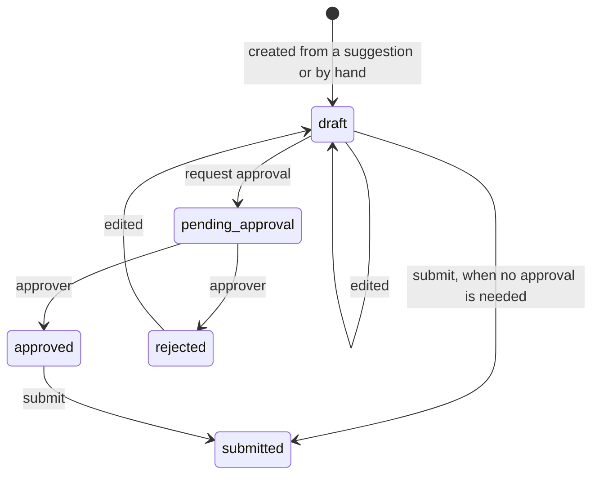

# Contract: Work-order drafts and audit log

Owner: 005 work orders. Consumers: 003 answer API (exposes the endpoints and writes audit events),
004 web client, 006 evaluation. Types: `src/copilot_contracts/work_orders.py`.

## Draft lifecycle

- **Approval needed** when the draft has parts, a required certification, a campaign code,
  `needs_specialist` or `return_visit`. `approval_reasons` lists which.
- **Required certification** lists `cert-*` groups only (not equipment-family or region groups).
  When a cited passage belongs to or is tagged with a restricted procedure, that procedure's
  `cert-*` groups are added by code and can never be removed, by edits or otherwise. Citations
  can't be edited.
- **Approvers** are users in `role-lead` for the asset's region. This is a stand-in until the
  constitution's TODO(WORK_ORDER_APPROVERS) is settled. An approver may not approve their own draft,
  and must be able to see every cited passage. If no approver qualifies, the draft reports
  `no eligible approver` in `approval_reasons` and can't be submitted. `eligible_approvers` lists
  the user IDs who qualify right now; `decision_note` holds the approver's note.
- **Target system** follows the asset's region: MaintPro for NA (North America), Servio for EU
  (Europe).
- **Submission** needs an explicit `confirm: true` from a human and an `Idempotency-Key`. In this
  build the MaintPro and Servio adapters are fakes that write
  `data/outbox/<system>/<idempotency_key>.json` and return a fake external reference. Resubmitting
  with the same key returns the same reference and writes nothing.
- **Visibility**: the creator, approvers for the region, and nobody else; and in every case only if
  the viewer can currently see every cited passage. This is re-checked on every read.
- Prefilled values come only from the answer's `work_order_suggestion`. User edits are allowed and
  recorded in the audit log.

## Audit log

Every one of these writes an `AuditEvent`: answer returned, source viewed, access denied, draft
created, edited, approved, rejected, submitted. Each records the user, the dataset version, the
passage IDs shown, and the outcome. Storage is the `app` schema in the same Postgres database:
append-only, never updated or deleted. Audit entries are shown to a user only under the same
visibility rule as drafts.
